# Infraestructura 2 – Seguridad de Redes
## Estudiante: Merolyn Mejía  
## Matrícula: 2025-0827  
## Asignatura: Seguridad de Redes

---

# Video demostrativo
https://youtu.be/yu1O00BC6iQ

---

# Índice

1. [Descripción del laboratorio](#1-descripción-del-laboratorio)
2. [Propósito del laboratorio](#2-propósito-del-laboratorio)
3. [Topología de la infraestructura](#3-topología-de-la-infraestructura)
4. [Plan de direccionamiento IP](#4-plan-de-direccionamiento-ip)
5. [Configuración de interfaces en FortiGate](#5-configuración-de-interfaces-en-fortigate)
6. [VLAN 10 y DHCP en FortiGate](#6-vlan-10-y-dhcp-en-fortigate)
7. [VLAN 10 y enlace Trunk del switch Cisco](#7-vlan-10-y-enlace-trunk-del-switch-cisco)
8. [Seguridad del switch: Port Security y BPDU Guard](#8-seguridad-del-switch-port-security-y-bpdu-guard)
9. [Políticas de seguridad de FortiGate](#9-políticas-de-seguridad-de-fortigate)
10. [Acceso del Jump Server al Web Server](#10-acceso-del-jump-server-al-web-server)
11. [Bloqueo de SSH desde la VLAN 10](#11-bloqueo-de-ssh-desde-la-vlan-10)
12. [Configuración de VPN Remote-Site con Shrew Soft](#12-configuración-de-vpn-remote-site-con-shrew-soft)
13. [Verificación del túnel IPsec en FortiGate](#13-verificación-del-túnel-ipsec-en-fortigate)
14. [Registros de tráfico de la VPN hacia el Jump Server](#14-registros-de-tráfico-de-la-vpn-hacia-el-jump-server)
15. [Prueba de HTTPS del Jump Server al Web Server](#15-prueba-de-https-del-jump-server-al-web-server)
16. [Prueba de RDP desde Jump Server hacia Web Server](#16-prueba-de-rdp-desde-jump-server-hacia-web-server)
17. [Prueba de SSH desde Jump Server hacia Web Server](#17-prueba-de-ssh-desde-jump-server-hacia-web-server)
18. [Acceso a RDWeb desde Windows 10](#18-acceso-a-rdweb-desde-windows-10)
19. [Instalación y acceso a RemoteApp Web Client HTML5](#19-instalación-y-acceso-a-remoteapp-web-client-html5)
20. [Aplicaciones del usuario sin privilegios](#20-aplicaciones-del-usuario-sin-privilegios)
21. [Aplicaciones del usuario con privilegios](#21-aplicaciones-del-usuario-con-privilegios)
22. [Asignación automática de direcciones por DHCP](#22-asignación-automática-de-direcciones-por-dhcp)
23. [Aplicaciones publicadas en RemoteApp](#23-aplicaciones-publicadas-en-remoteapp)
24. [Política de la VPN limitada al Jump Server](#24-política-de-la-vpn-limitada-al-jump-server)
25. [Resultados y observaciones](#25-resultados-y-observaciones)
26. [Conclusión](#26-conclusión)

---

---

# 1. Descripción del laboratorio
En esta práctica armé una red en GNS3 para demostrar cómo se puede controlar el acceso a los servidores.
Utilicé un FortiGate para aplicar las reglas de seguridad, un switch Cisco para conectar a los usuarios,
un Web Server Ubuntu que representa el Sistema de Caja y un Jump Server con Windows Server 2022.
También configuré una VPN para el acceso remoto y RemoteApp para que los usuarios puedan ver distintas aplicaciones según sus permisos.
La conexión a Internet está simulada mediante NAT de GNS3, por lo que la dirección WAN que aparece en la práctica es privada.

---

# 2. Propósito del laboratorio
El propósito de esta infraestructura es evitar que todos los usuarios puedan entrar libremente a los servidores. P
ara lograrlo, separé las redes, limité los servicios permitidos en FortiGate y utilicé un Jump Server como punto intermedio de acceso.
La práctica también busca demostrar que un usuario sin privilegios puede tener menos aplicaciones publicadas que otro usuario autorizado, 
y que el firewall puede bloquear expresamente servicios como SSH desde la red de usuarios.

---

# 3. Topología de la infraestructura
La topología está formada por FortiGate, un switch Cisco, el ISP simulado, dos servidores y tres equipos de usuario o prueba. 
Los dos Alpine representan a `USUARIO-sp` (sin privilegios) y `USUARIO-cp` (con privilegios). Entre ellos coloqué una máquina Windows 10, 
que utilicé para abrir RDWeb desde un cliente gráfico y para conectarme a la VPN con Shrew Soft.
Los Alpine me permitieron representar a los usuarios sin consumir tantos recursos del equipo. Windows 10 complementa las pruebas porque 
permite utilizar un navegador y el cliente VPN de manera gráfica. FortiGate conecta la VLAN de usuarios con las dos redes independientes de servidores.

## Diagrama
Evidencia 01. Topología de la infraestructura
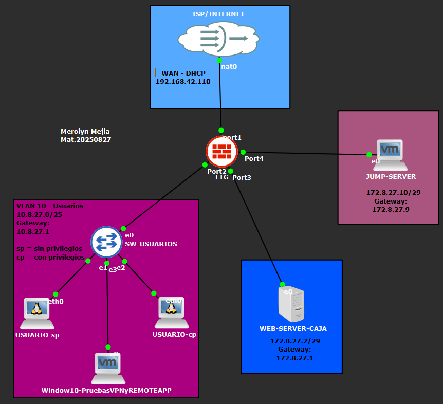

---

## 4. Plan de direccionamiento IP

Para realizar esta práctica, utilicé un direccionamiento IP basado en mi matrícula **2025-0827**, tomando los números **8 y 27** como referencia para identificar las redes internas de la infraestructura.

Organicé las direcciones IP de manera que los usuarios, el Web Server y el Jump Server estuvieran en redes diferentes. Para los usuarios utilicé una máscara **/25**, mientras que para cada servidor utilicé una máscara **/29**, tal como se solicitó en la práctica.

### Tabla de direccionamiento IP

| Dispositivo | Interfaz o red | Dirección IP | Máscara | Gateway |
|---|---|---|---|---|
| FortiGate | WAN (port1) | 192.168.42.110 | /24 | 192.168.42.1 |
| FortiGate | VLAN 10 (port2) | 10.8.27.1 | /25 | — |
| FortiGate | LAN Web Server (port3) | 172.8.27.1 | /29 | — |
| FortiGate | LAN Jump Server (port4) | 172.8.27.9 | /29 | — |
| USUARIO-sp (Alpine) | VLAN 10 | 10.8.27.2 | /25 | 10.8.27.1 |
| USUARIO-cp (Alpine) | VLAN 10 | 10.8.27.3 | /25 | 10.8.27.1 |
| Windows 10 (Pruebas) | VLAN 10 | 10.8.27.4 | /25 | 10.8.27.1 |
| Web Server (Ubuntu) | LAN Web | 172.8.27.2 | /29 | 172.8.27.1 |
| Jump Server (Windows Server 2022) | LAN Jump | 172.8.27.10 | /29 | 172.8.27.9 |
| Cliente VPN | VPN IPsec | 10.99.27.10 | /24 | Asignado por la VPN |

### Explicación del direccionamiento

La red **10.8.27.0/25** corresponde a la VLAN 10, donde están conectados los dos usuarios Alpine y la máquina Windows 10 utilizada para realizar las pruebas. Estas direcciones se asignan automáticamente mediante DHCP desde FortiGate.

El **Web Server** utiliza la red **172.8.27.0/29**, mientras que el **Jump Server** utiliza la red **172.8.27.8/29**. Separé ambos servidores para que FortiGate pudiera controlar la comunicación entre ellos y permitir solamente los servicios HTTPS, RDP y SSH.

Para la VPN utilicé el rango **10.99.27.10 a 10.99.27.20**, desde el cual se asignan direcciones a los clientes remotos. La política de seguridad de la VPN tiene como destino permitido el Jump Server.

Por último, la dirección **192.168.42.110** corresponde a la interfaz WAN del FortiGate, conectada al ISP simulado mediante NAT en GNS3. Por tratarse de un laboratorio, utilicé una dirección privada para representar esta conexión.

De esta manera, el direccionamiento está organizado según la función de cada equipo, facilita la identificación de las redes y permite aplicar las políticas de seguridad de forma separada.

---

# 5. Configuración de interfaces en FortiGate
Desde la interfaz gráfica de FortiGate configuré las conexiones de cada segmento. `port1` 
se utiliza como WAN, `port2` se conecta al switch y transporta la VLAN 10, `port3` conecta al Web Server y `port4` conecta al Jump Server.
Separar los servidores en puertos y redes diferentes permite que FortiGate revise las conexiones entre ellos antes de permitirlas. 
La captura muestra las interfaces y sus direcciones.
Evidencia 02. Configuración de interfaces en FortiGate
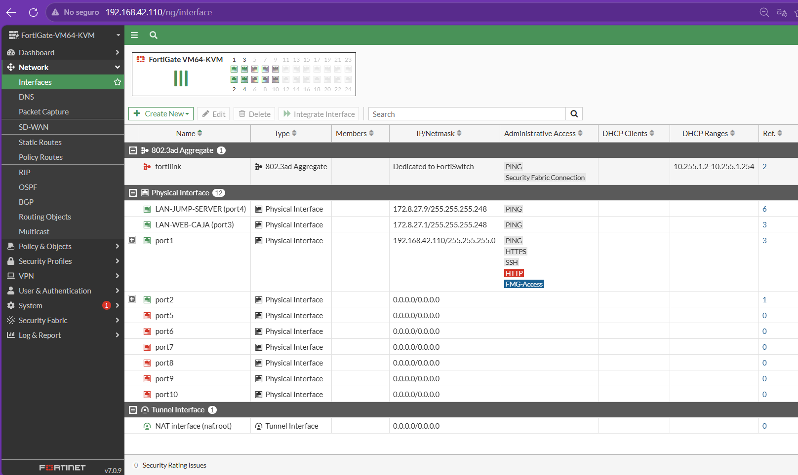

---

# 6. VLAN 10 y DHCP en FortiGate
Creé la interfaz `VLAN10-USUARIOS` con la puerta de enlace `10.8.27.1/25` y habilité DHCP para entregar 
direcciones automáticamente. De esta manera, los equipos de usuario reciben su IP sin tener que configurarla manualmente.
La VLAN 10 sirve para agrupar a los usuarios y distinguir su tráfico del tráfico de los servidores.
Evidencia 03. VLAN 10 y DHCP en FortiGate
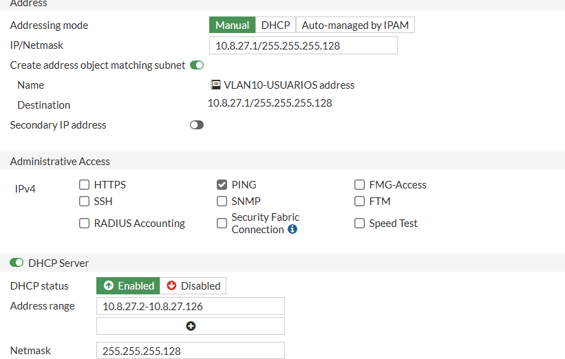

---

# 7. VLAN 10 y enlace Trunk del switch Cisco
En el switch Cisco creé la VLAN 10. Configuré `Gi0/0` como enlace trunk hacia FortiGate y los puertos `Gi0/1`, 
`Gi0/2` y `Gi0/3` como puertos de acceso para los dos Alpine y Windows 10.
Para comprobarlo utilicé los comandos `show vlan brief` y `show interfaces trunk`. 
Con estas verificaciones pude confirmar que la VLAN estaba creada y que el enlace con FortiGate transportaba la red de usuarios.
Evidencia 04. VLAN 10 y enlace Trunk del switch Cisco
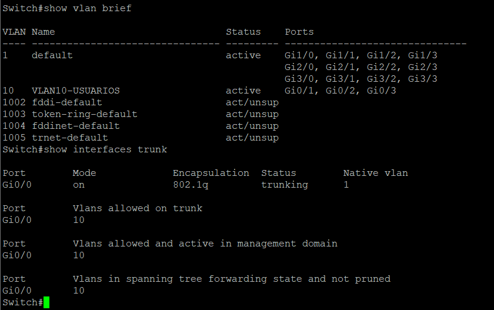

---

# 8. Seguridad del switch: Port Security y BPDU Guard
En los puertos de acceso configuré Port Security para limitar los dispositivos que se pueden conectar. 
Utilicé un máximo de una dirección MAC por puerto y el modo `restrict`, de modo que el switch pueda restringir tráfico que no cumpla la regla. 
También configuré PortFast y BPDU Guard en los puertos de usuario.
Verifiqué estas opciones con `show port-security`, `show port-security interface gi0/1` y `show running-config interface gi0/1`. 
Esto ayuda a documentar que el switch no solamente conecta equipos, sino que también tiene controles de seguridad.
Evidencia 05. Seguridad del switch: Port Security y BPDU Guard
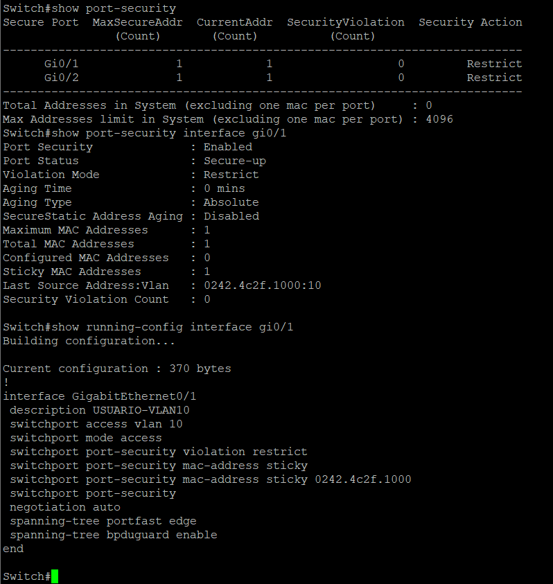

---

# 9. Políticas de seguridad de FortiGate
En Policy & Objects → Firewall Policy organicé las reglas que controlan el tráfico entre la VLAN 10, el Jump Server, 
el Web Server y la VPN. Cada política indica de dónde viene la conexión, a dónde puede llegar, qué servicio utiliza y si debe permitirse o bloquearse.
Estas reglas son la parte principal de la seguridad de la práctica, porque la conectividad 
no depende solamente de que los equipos tengan una dirección IP, sino también de los permisos definidos en FortiGate.
Evidencia 06. Políticas de seguridad de FortiGate
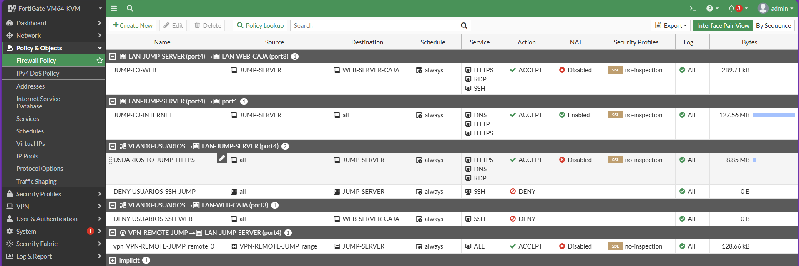

---

# 10. Acceso del Jump Server al Web Server
Creé la política `JUMP-TO-WEB` desde la interfaz del Jump Server (`port4`) hacia la interfaz del Web Server (`port3`). 
En ella seleccioné como origen el objeto `JUMP-SERVER`, como destino `WEB-SERVER-CAJA` y permití solamente HTTPS, RDP y SSH. 
Dejé NAT desactivado para esta comunicación interna.
El objetivo es que el Jump Server pueda abrir la página del servidor web, conectarse a su escritorio remoto y administrarlo por SSH, sin tener una regla abierta para todos los servicios.
Evidencia 07. Acceso del Jump Server al Web Server
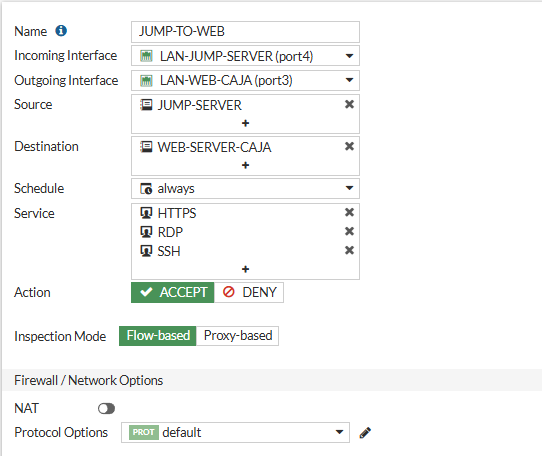

---

# 11. Bloqueo de SSH desde la VLAN 10
Agregué políticas explícitas con acción DENY para impedir que los usuarios de la VLAN 10 entren directamente por SSH al Jump Server o al Web Server. 
Estas reglas ayudan a evitar que un usuario normal intente administrar los servidores por el puerto 22.
En la captura se muestran las reglas de bloqueo. La evidencia corresponde a la configuración de la política; 
para demostrar una violación concreta también se necesitaría un intento bloqueado registrado.
Evidencia 08. Bloqueo de SSH desde la VLAN 10
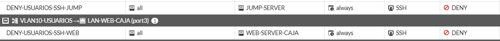

---

# 12. Configuración de VPN Remote-Site con Shrew Soft
Para el acceso remoto configuré una VPN IPsec en FortiGate y utilicé Shrew Soft VPN Client en Windows 10. 
El cliente se conecta a la dirección WAN simulada del FortiGate y, cuando el túnel se establece, recibe una dirección de la red VPN, como `10.99.27.10`.
Esta conexión se creó para que un usuario remoto llegue a la infraestructura a través del túnel, 
sin habilitar acceso general a todos los servidores. En la captura se observa el cliente Shrew Soft con el túnel habilitado.
Evidencia 09. Configuración de VPN Remote-Site con Shrew Soft
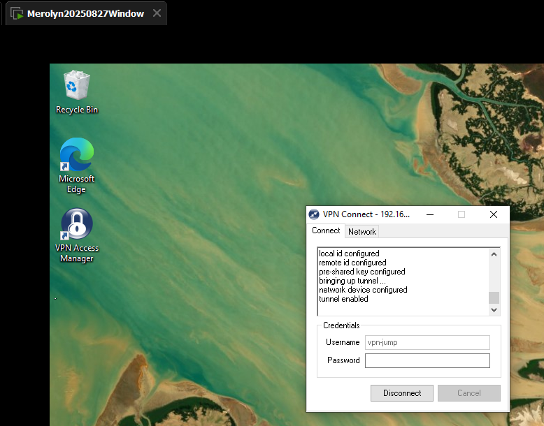

---

# 13. Verificación del túnel IPsec en FortiGate
Después de conectar Shrew Soft, entré a VPN → IPsec Tunnels en la GUI de FortiGate. Allí comprobé que `VPN-REMOTE-JUMP` aparecía activo y con una conexión dialup.
Esta prueba confirma que el túnel VPN se estableció entre el cliente y FortiGate. Por sí sola no demuestra que todos los servicios del Jump Server puedan abrirse desde la VPN.
Evidencia 10. Verificación del túnel IPsec en FortiGate
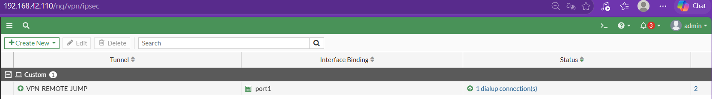

---

# 14. Registros de tráfico de la VPN hacia el Jump Server
En Log & Report → Forward Traffic filtré los registros por la IP de origen `10.99.27.10`. Los resultados muestran como destino `172.8.27.10`, 
que corresponde al Jump Server, y la política `vpn_VPN-REMOTE-JUMP_remote_0`. Esta evidencia es útil porque muestra que FortiGate identifica el 
tráfico que llega desde la VPN y le aplica la política correspondiente. En pruebas anteriores, la conexión HTTPS mediante VPN no llegó a completarse correctamente; 
por eso estos registros se presentan como evidencia de tráfico y aplicación de política, no como una prueba de acceso HTTPS exitoso.
Evidencia 11. Registros de tráfico de la VPN hacia el Jump Server
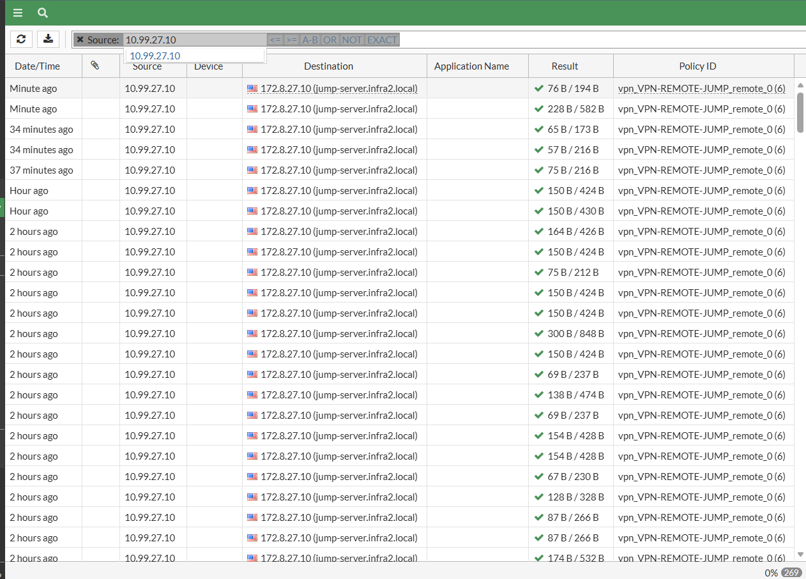

---

# 15. Prueba de HTTPS del Jump Server al Web Server
Desde PowerShell del Jump Server ejecuté `Test-NetConnection 172.8.27.2 -Port 443`. El resultado `TcpTestSucceeded: True` confirmó que 
el puerto HTTPS del Web Server respondía desde el Jump Server. Esta prueba se relaciona con la política `JUMP-TO-WEB`, donde HTTPS es uno de los servicios permitidos. 
El resultado confirma conectividad TCP al puerto 443; no sustituye una revisión completa del contenido de la aplicación web.
Evidencia 12. Prueba de HTTPS del Jump Server al Web Server
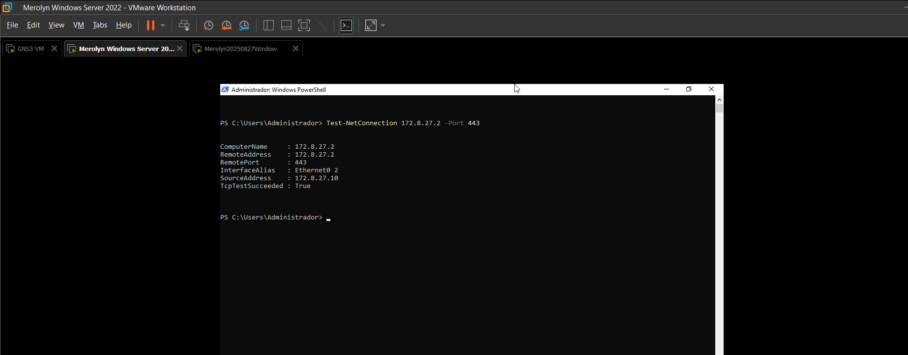

---

# 16. Prueba de RDP desde Jump Server hacia Web Server
En el Jump Server abrí Conexión a Escritorio remoto (`mstsc`) y escribí la dirección `172.8.27.2`. Se abrió el inicio de sesión de XRDP de Ubuntu y, 
después de ingresar las credenciales del laboratorio, pude ver su escritorio y abrir una terminal.
Con esto comprobé que el servicio RDP funciona entre el Jump Server y el Web Server, tal como se permitió en la política de FortiGate.
Evidencia 13. Prueba de RDP desde Jump Server hacia Web Server
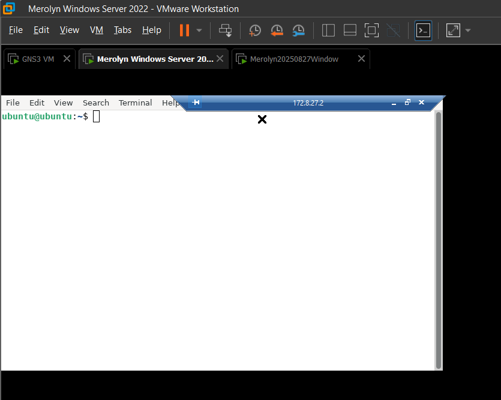

---

# 17. Prueba de SSH desde Jump Server hacia Web Server
Abrí PuTTY desde el Jump Server y me conecté por SSH a `172.8.27.2`, utilizando el puerto 22. Después de iniciar sesión apareció la terminal de Ubuntu.
Esta prueba demuestra que el Jump Server puede administrar el Web Server mediante SSH, mientras que el acceso SSH directo desde la VLAN de usuarios está restringido mediante reglas separadas.
Evidencia 14. Prueba de SSH desde Jump Server hacia Web Server
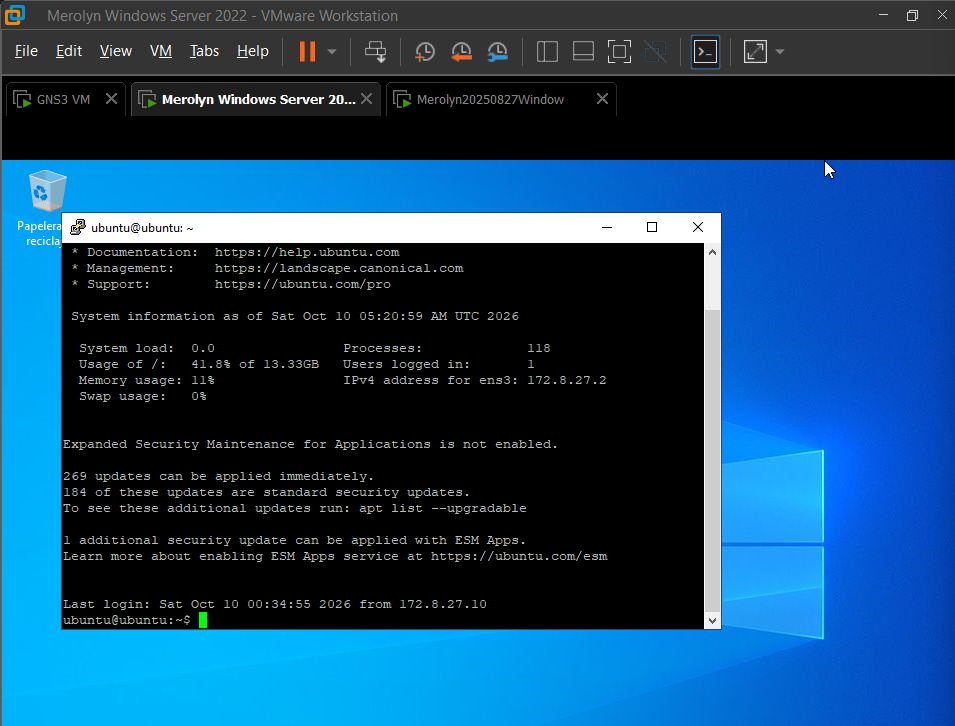

---

# 18. Acceso a RDWeb desde Windows 10
Utilicé la máquina Windows 10 conectada a la VLAN 10 para abrir Microsoft Edge y entrar a `https://172.8.27.10/RDWeb/Pages/`. 
El portal RDWeb del Jump Server cargó y permitió iniciar sesión con el usuario del laboratorio.
Esta prueba muestra que un equipo cliente puede llegar al portal web del Jump Server y ver las aplicaciones que tiene publicadas. 
No es una prueba realizada por VPN, sino desde la red de usuarios.
Evidencia 15. Acceso a RDWeb desde Windows 10
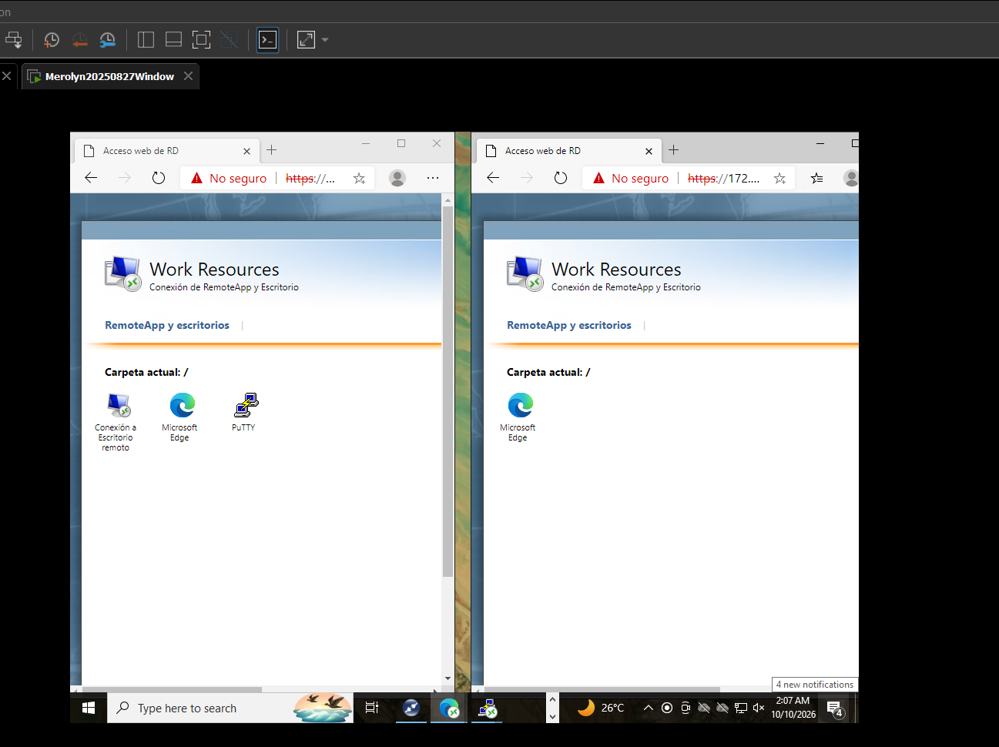

---

# 19. Instalación y acceso a RemoteApp Web Client HTML5
En Windows Server 2022 configuré Remote Desktop Services y publiqué el cliente web HTML5. Para comprobar que el portal estaba disponible, 
abrí `https://localhost/RDWeb/webclient/` desde el Jump Server.
El portal mostró la pantalla de inicio de sesión y, después de autenticarme, los recursos publicados. Durante las pruebas, 
abrir Edge desde HTML5 produjo una desconexión, por lo que esta captura demuestra que el portal está disponible y muestra las aplicaciones, pero no que la ejecución remota funcione completamente.
Evidencia 16. Instalación y acceso a RemoteApp Web Client HTML5
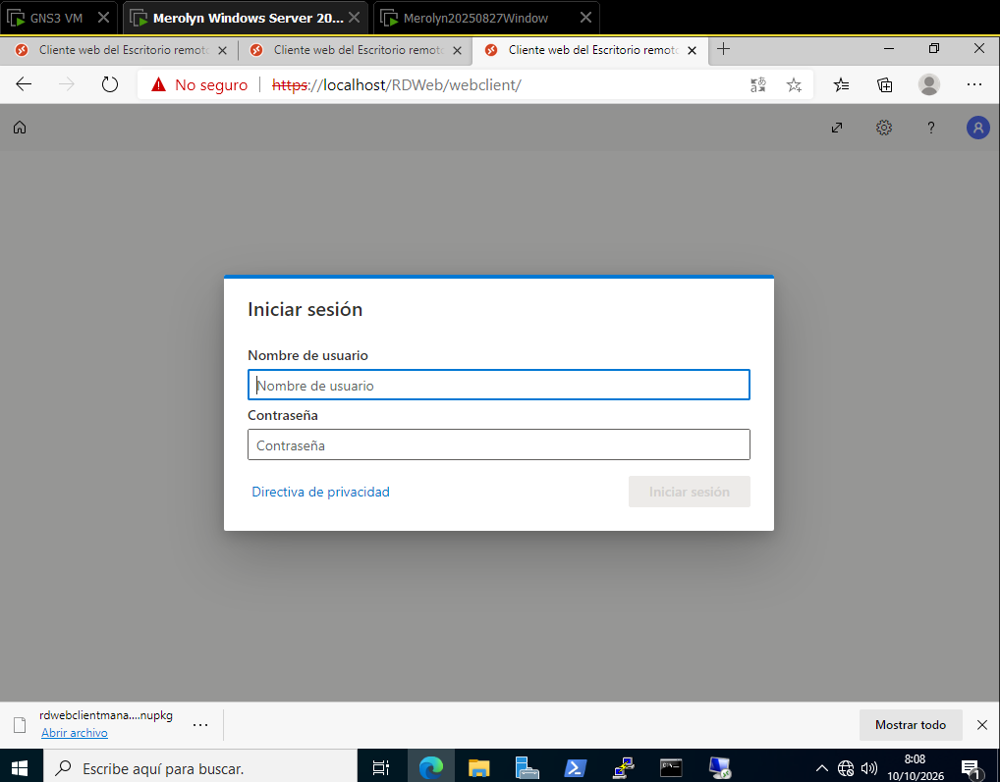

---

# 20. Aplicaciones del usuario sin privilegios
Creé el usuario `USUARIO-sp` y configuré sus permisos para que solamente tenga publicada la aplicación Microsoft Edge. 
Al iniciar sesión en RemoteApp Web Client con este usuario, la página Work Resources mostró únicamente Edge.
Esto permite comprobar que el usuario sin privilegios no ve PuTTY ni Conexión a Escritorio remoto entre sus aplicaciones publicadas.
Evidencia 17. Aplicaciones del usuario sin privilegios
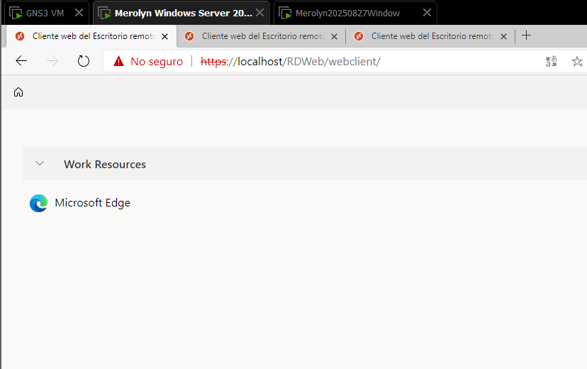

---

# 21. Aplicaciones del usuario con privilegios
También creé el usuario `USUARIO-cp` y le asigné acceso a las tres aplicaciones: Microsoft Edge, PuTTY y Conexión a Escritorio remoto. 
Al entrar al portal con este usuario, las tres aparecieron en Work Resources.
La comparación entre los dos usuarios muestra que configuré diferentes permisos de publicación. 
Estas capturas comprueban qué aplicaciones se muestran a cada usuario, no necesariamente que todas puedan ejecutarse desde HTML5.
Evidencia 18. Aplicaciones del usuario con privilegios
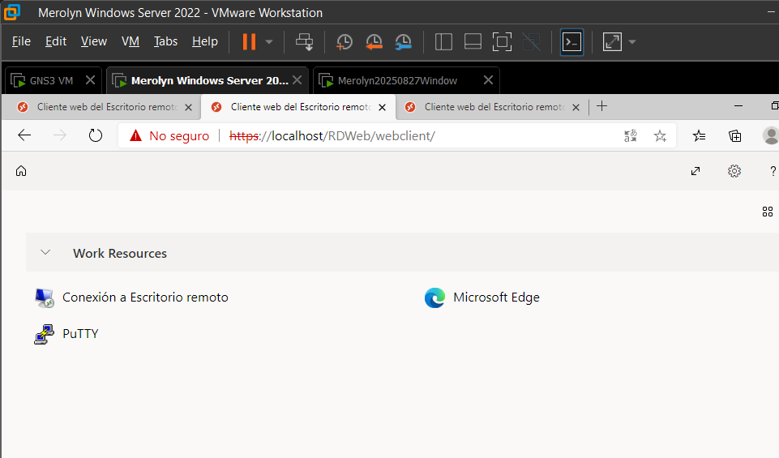

---

# 22. Asignación automática de direcciones por DHCP
Comprobé que los usuarios Alpine recibieran direcciones dentro de la red `10.8.27.0/25`. Durante las pruebas se utilizaron `10.8.27.2` para `USUARIO-sp`, 
`10.8.27.3` para `USUARIO-cp` y `10.8.27.4` para la interfaz de Windows 10 conectada a la VLAN.
Esto demuestra que la red de usuarios cuenta con un esquema de direccionamiento funcional y que FortiGate entrega las direcciones mediante DHCP.
Evidencia 19. Asignación automática de direcciones por DHCP
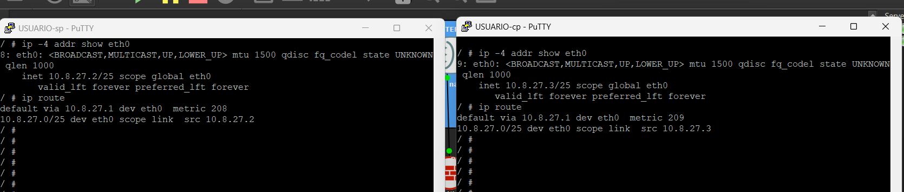

---

# 23. Aplicaciones publicadas en RemoteApp
En Server Manager → Remote Desktop Services → Collections → QuickSessionCollection publiqué Microsoft Edge, PuTTY y Conexión a Escritorio remoto. 
Después organicé los permisos de acceso para que cada usuario pudiera ver las aplicaciones que le correspondían.
Esta captura muestra la configuración de publicación en Windows Server, mientras que las capturas de los usuarios muestran el resultado al iniciar sesión.
Evidencia 20. Aplicaciones publicadas en RemoteApp
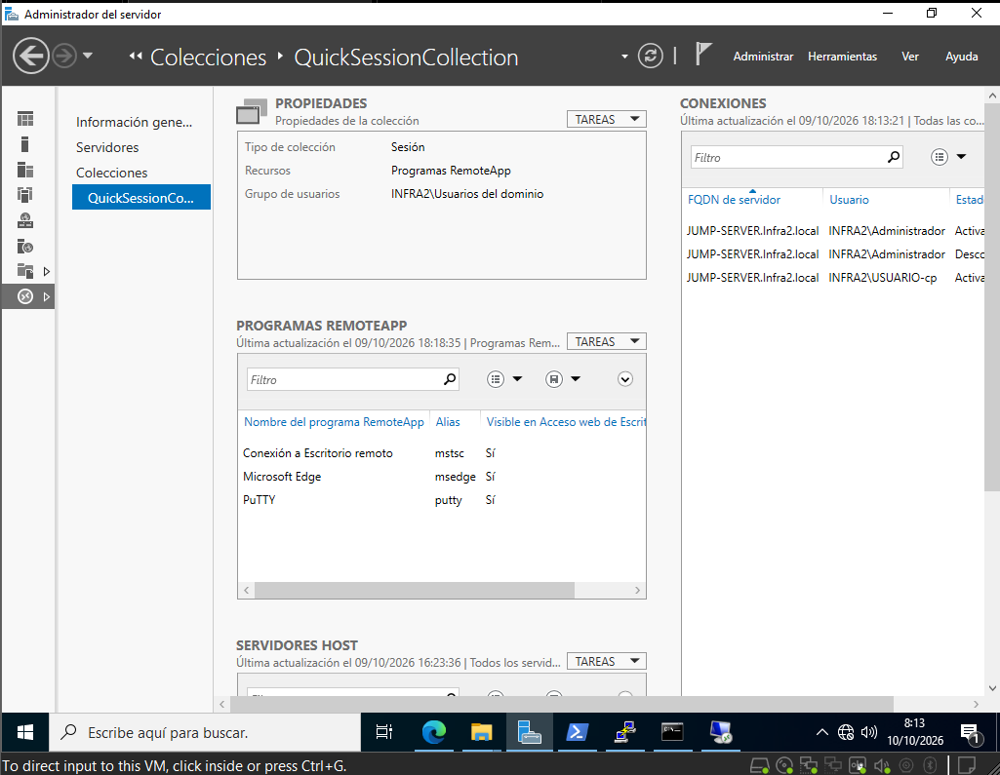

---

# 24. Política de la VPN limitada al Jump Server
En FortiGate configuré la política `vpn_VPN-REMOTE-JUMP_remote_0` con entrada desde la interfaz VPN y salida hacia la red del Jump Server. 
Seleccioné como destino el objeto `JUMP-SERVER`, correspondiente a `172.8.27.10`, y dejé NAT desactivado.
Esta regla limita el destino permitido del tráfico de la VPN al Jump Server. El servicio aparece configurado como `ALL`, 
por lo que la política no limita los puertos dentro de ese destino. Las demás redes no están incluidas como destino en esa regla.
Evidencia 21. Política de la VPN limitada al Jump Server
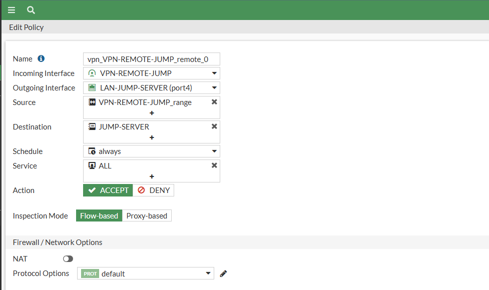

---

# 25. Resultados y observaciones
Con esta práctica pude verificar la organización de la VLAN 10, la entrega de direcciones por DHCP, las políticas del firewall, 
la conexión del túnel IPsec y los tres servicios permitidos desde el Jump Server hacia el Web Server: HTTPS, RDP y SSH. 
También comprobé que los usuarios sin privilegios y con privilegios tienen diferentes aplicaciones publicadas en RDWeb.

---

## 26. Conclusión 
Esta práctica me ayudó a entender cómo se puede proteger una red sin dejar todos los accesos abiertos. 
Aprendí a separar a los usuarios de los servidores, crear reglas en FortiGate para permitir solamente los servicios necesarios y utilizar un Jump Server para centralizar el acceso.
También pude trabajar con una VPN IPsec y con RemoteApp para mostrar diferentes aplicaciones según el usuario. 
Las capturas permiten ver lo que se configuró y los resultados obtenidos durante las pruebas. 
En general, el laboratorio me sirvió para poner en práctica conceptos de segmentación, seguridad del switch y control de acceso que hemos visto en Seguridad de Redes.
